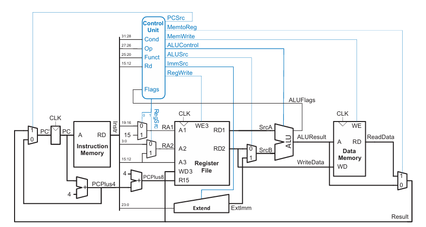

# ARM-32_bit-16_Register (ARMv4 Single-Cycle Processor)

Thiết kế và mô phỏng bộ xử lý **ARMv4 32-bit đơn chu kỳ (Single-Cycle)** bằng ngôn ngữ mô tả phần cứng **SystemVerilog**, phát triển dựa trên kiến trúc chuẩn trong giáo trình *Digital Design and Computer Architecture (ARM Edition)* — Sarah L. Harris & David Harris.

Dự án bao gồm đầy đủ khối đường dẫn dữ liệu (Datapath), khối điều khiển (Controller), bộ dịch thanh ghi (Barrel Shifter), hệ thống cờ trạng thái 4-bit độc lập (`FlagW[3:0]`) và bộ kiểm thử tự động (Self-Checking Testbench) xác minh 35 lệnh hợp ngữ ARMv4.

---

## Kiến trúc tổng quan



### Tính năng kiến trúc nổi bật
- **Độ rộng dữ liệu & địa chỉ:** 32-bit (`[31:0]`), hỗ trợ không gian địa chỉ định byte.
- **Tập thanh ghi (Register File):** 16 thanh ghi đa dụng 32-bit (`R0` – `R15`), trong đó `R15` đóng vai trò bộ đếm chương trình (`PC`) và tự động tính toán giá trị `PC + 8` theo chuẩn pipeline 3 tầng của ARMv4.
- **Khối ALU 32-bit mở rộng (`alu.sv`):** Hỗ trợ đầy đủ 16 mã lệnh xử lý dữ liệu (`AND`, `EOR`, `SUB`, `RSB`, `ADD`, `ADC`, `SBC`, `RSC`, `TST`, `TEQ`, `CMP`, `CMN`, `ORR`, `MOV`, `BIC`, `MVN`).
- **Bộ dịch thanh ghi (`operand2_shifter.sv`):** Hỗ trợ dịch chuyển toán hạng thứ hai (`Operand2`) trực tiếp trong một chu kỳ xung nhịp với các chế độ `LSL`, `LSR`, `ASR`, `ROR` (dịch theo hằng số `shamt5` hoặc giá trị thanh ghi `Rs`).
- **Quản lý cờ trạng thái (`CPSR`):** Tín hiệu điều khiển `FlagW[3:0]` cho phép cập nhật độc lập nhóm cờ số học (`C`, `V`) và cờ logic (`N`, `Z`) khi lệnh có hậu tố `S`.
- **Thực thi có điều kiện (Conditional Execution):** Kiểm tra 4-bit trường `Cond[31:28]` của mọi lệnh trước khi cho phép ghi thanh ghi, ghi bộ nhớ hoặc nhảy (`PCSrc`).

---

## Cấu trúc thư mục dự án

```text
ARM-32_bit-16_Resgister/
├── ARM_Project/                    # Mã nguồn thiết kế phần cứng & Testbench (SystemVerilog)
│   ├── top.sv                      # Mô-đun cấp cao nhất kết nối lõi ARM, IMEM và DMEM
│   ├── arm.sv                      # Lõi xử lý ARM (Controller & Datapath)
│   ├── alu.sv                      # Khối tính toán số học và logic 32-bit (16 opcodes)
│   ├── operand2_shifter.sv         # Bộ dịch Barrel Shifter 32-bit
│   ├── extend.sv                   # Khối mở rộng hằng số tức thời (Immediate Extension)
│   ├── adder.sv                    # Bộ cộng 32-bit (PC+4, PC+8)
│   ├── mux2.sv                     # Bộ ghép kênh 2-sang-1
│   ├── flopr.sv                    # Thanh ghi D Flip-Flop có reset đồng bộ/bất đồng bộ
│   ├── flopenr.sv                  # Thanh ghi D Flip-Flop có tín hiệu cho phép (Enable)
│   ├── imem.sv                     # Bộ nhớ lệnh (Instruction Memory - ROM)
│   ├── dmem.sv                     # Bộ nhớ dữ liệu (Data Memory - RAM)
│   ├── memfile.dat                 # Mã máy hệ thập lục phân (Hex) của chương trình 35 lệnh
│   └── tb_top.sv                   # Testbench tự động kiểm tra (Self-checking)
├── Figure/                         # Sơ đồ khối, RTL Viewer và kết quả dạng sóng mô phỏng
│   ├── single_cycle.png            # Sơ đồ kiến trúc tổng quát bộ xử lý đơn chu kỳ
│   ├── control_unit.png            # Sơ đồ khối điều khiển (Decoder & Conditional Logic)
│   ├── arm_registers.png           # Cấu trúc tập thanh ghi ARM (R0 -
